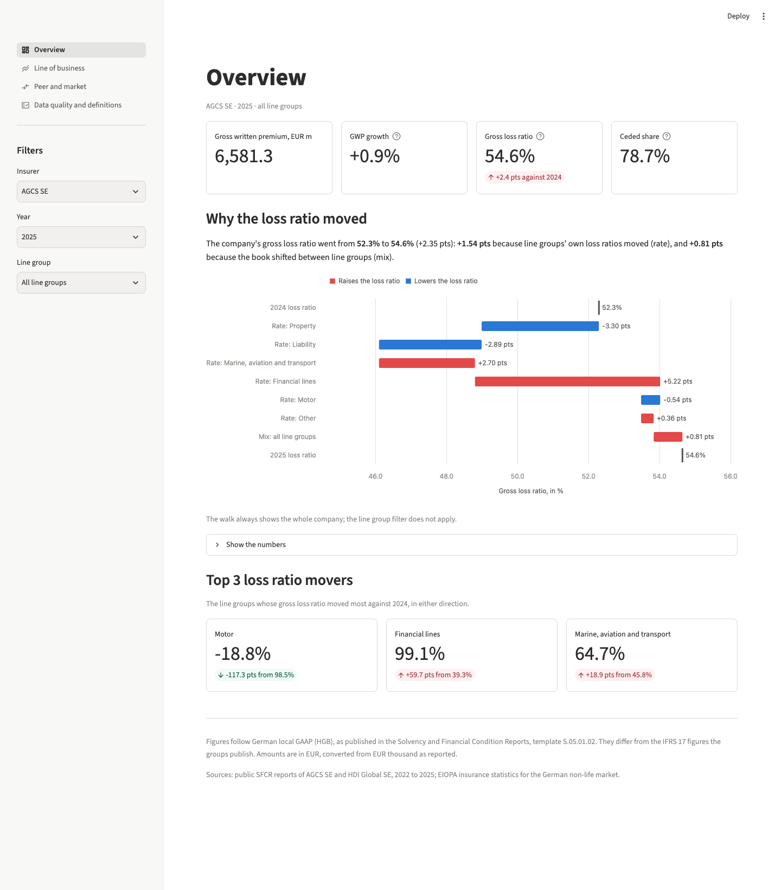
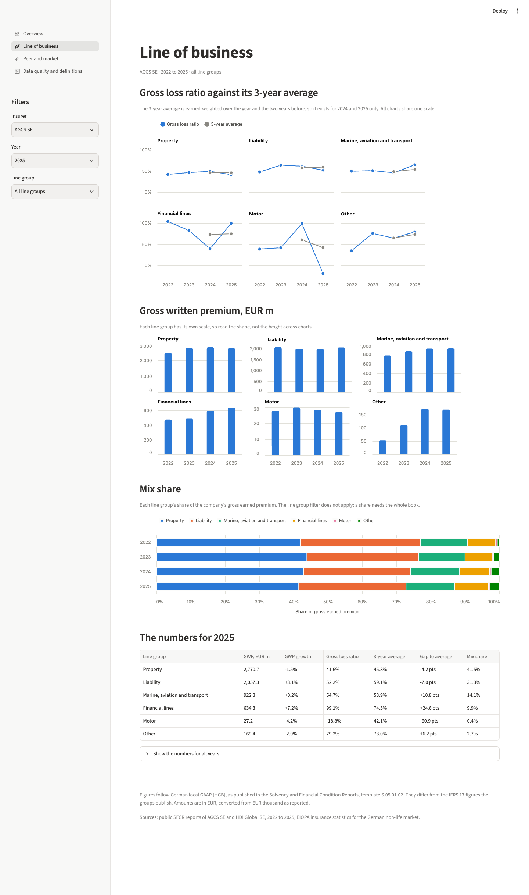
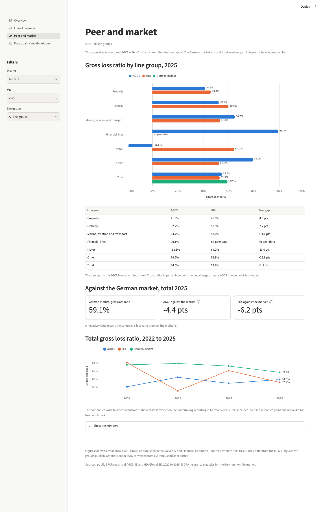
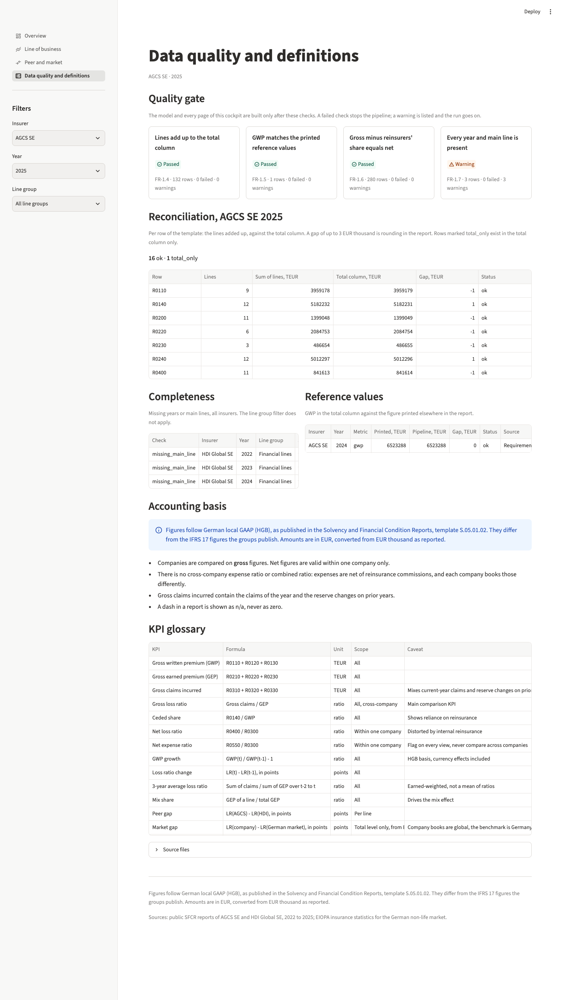
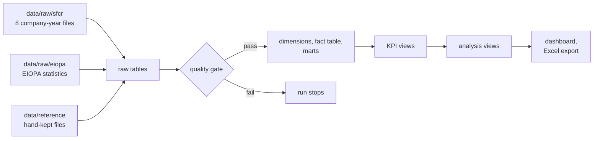

# Financial performance steering cockpit

A data pipeline that explains a commercial insurer's results by line of business, against a peer and the German market, from public Solvency II data.

## The problem

A Business Partnering team in commercial property and casualty insurance answers three questions every reporting cycle: How did we do? Why? What should we do? Today an analyst answers them by hand in Excel and PowerPoint.

This project answers them from governed data. It loads the published figures of two insurers, checks them, and builds the KPIs and the analysis views a steering dashboard reads.

All data is public: the Solvency and Financial Condition Reports (SFCR) of AGCS SE and HDI Global SE for 2022 to 2025, and the insurance statistics of EIOPA. The two companies are data sources only. This project is not affiliated with them.

## Status

Version 1 is in progress.

| Part | State |
| --- | --- |
| Ingestion, quality gate, data model, KPIs, analysis views | Built and tested |
| Excel export with live formulas | Built and tested |
| Dashboard, four pages, in Streamlit | Built and tested |
| Dashboard in Power BI Desktop | Planned; it will read the same SQL views |
| AI commentary, Ask your P&L, EMT deck | Version 2 |

## How to run

You need Python 3.11 or newer and `make`.

1. Clone the repository and go into its folder.
2. Create the environment: `make setup`
3. Build everything from the raw files: `make all`
4. Open the dashboard: `make app`
5. Run the tests: `make test`

`make app` starts the dashboard and opens it in your browser at `http://localhost:8501`. Press Ctrl+C in the terminal to stop it.

`make setup` uses `python3.12`. If your Python has another name, pass it: `make setup BOOTSTRAP_PYTHON=python3.11`.

`make all` takes a few seconds and prints one line per step:

```text
ingest   raw_s050102: 1186 rows from 8 files (8 loaded, 0 unchanged, 0 removed)
ingest   raw_eiopa: 921 rows (loaded)
quality  FR-1.4 dq_reconciliation: ok (132 rows, 0 fail, 0 warn)
quality  FR-1.5 dq_reference_check: ok (1 rows, 0 fail, 0 warn)
quality  FR-1.6 dq_net_check: ok (280 rows, 0 fail, 0 warn)
quality  FR-1.7 dq_completeness: WARN (3 rows, 0 fail, 3 warn)
marts    28 models built
```

The three completeness warnings are expected: HDI Global SE reports no financial lines column for 2022 to 2024.

It writes three things:

| Output | Where | Tracked in git |
| --- | --- | --- |
| The warehouse, a DuckDB file | `warehouse/cockpit.duckdb` | No |
| The Excel export | `exports/cockpit_marts.xlsx` | No |
| The KPI glossary | `docs/kpi_definitions.md` | Yes |

Without `make`, the same steps are:

```bash
python3.12 -m venv .venv
.venv/bin/python -m pip install -e ".[dev]"
.venv/bin/python -m cockpit.pipeline
.venv/bin/python -m cockpit.export_excel
.venv/bin/python -m cockpit.kpi_docs
.venv/bin/python -m streamlit run app/cockpit_app.py
.venv/bin/python -m pytest
```

To query the results yourself, open `warehouse/cockpit.duckdb` with any DuckDB client and start with `analysis_peer_market`, `analysis_lr_walk` or `analysis_flags`.

## The dashboard

Four pages, one set of filters (insurer, year, line group) in the sidebar. The dashboard calculates nothing: every number on a page is a number in a SQL view. Each page ends with the accounting basis note.

**Overview.** Premium, growth, loss ratio and ceded share; why the loss ratio moved; the three line groups that moved most.



**Line of business.** Loss ratio against its 3-year average, premium and mix share per line group.



**Peer and market.** The focus company against the peer per line group, and both against the German market in total.



**Data quality and definitions.** The quality gate, the reconciliation per row, the accounting basis and the KPI glossary.



## Architecture



Nothing downstream reads the raw files. The model builds only after the quality gate passes.

| Layer | Folder | What it holds |
| --- | --- | --- |
| Raw | `sql/10_raw` | The files as delivered, plus source file and load time on every row |
| Quality | `sql/15_quality` | Four checks, one table each |
| Staging | `sql/20_staging` | The German non-life market from EIOPA |
| Marts | `sql/30_marts` | Dimensions, fact table, marts, 13 KPI views, the KPI glossary |
| Analysis | `sql/40_analysis` | Year over year, loss ratio walk, rolling average, peer and market, flags |

Each SQL file builds exactly one table or view. Python (`src/cockpit`) loads the files, runs the SQL in order and enforces the gate.

A second run changes nothing: a file that has not changed is not loaded again.

## The quality gate

| Check | Rule | If it fails |
| --- | --- | --- |
| Reconciliation | The lines add up to the total column per insurer, year and row, within 3 TEUR | The run stops |
| Reference values | GWP equals the figure printed elsewhere in the report, within 1 TEUR | The run stops |
| Completeness | Every insurer has every year; every main line is present | A missing year stops the run; a missing line is a warning |
| Net check | Gross minus reinsurers' share equals net, within 3 TEUR | A warning |

The failing rows stay in the `dq_` tables after a stopped run.

## KPIs and analysis views

The 13 KPIs and their formulas are in [docs/kpi_definitions.md](docs/kpi_definitions.md). That page is generated from the `kpi_definitions` table, which the dashboard tooltips also read.

| View | Answers |
| --- | --- |
| `analysis_yoy` | How did premium and loss ratio move against last year? |
| `analysis_lr_walk` | How much of the loss ratio change is rate (each line's own ratio moved) and how much is mix (the book shifted between lines)? |
| `analysis_rolling_avg` | Is the loss ratio above or below its 3-year average? |
| `analysis_peer_market` | Where do we stand against the peer and the German market? |
| `analysis_flags` | Which lines need a comment, by fixed rules? |

## Data

| Source | Content | Where |
| --- | --- | --- |
| AGCS SE and HDI Global SE, SFCR template S.05.01.02 | Premiums, claims and expenses by line of business, 2022 to 2025 | `data/raw/sfcr`, one file per company and year |
| EIOPA insurance statistics, Solo, Annual | Premiums, claims and expenses per country, 2016 to 2025 | `data/raw/eiopa/SA_Premiums_Claims_Expenses.csv` |
| GDV statistics booklet, September 2025 | German market loss ratios for three lines, 2022 to 2024 | `data/reference/market_lob_gdv.csv`, typed in by hand with table and page per row |

To refresh the EIOPA file, download "Premiums, claims and expenses", Solo, Annual, csv from the [EIOPA insurance statistics page](https://www.eiopa.europa.eu/tools-and-data/insurance-statistics_en) and replace the file in `data/raw/eiopa`. The folder must hold exactly one csv file. The pipeline keeps the rows for Germany.

## Data caveats

Read these before you compare any number from this project with a published one.

- **Accounting basis.** The SFCR figures follow German local GAAP (HGB). They differ from the IFRS 17 figures the groups publish.
- **Gross for comparison.** Companies are compared on gross figures. Net figures are valid within one company only.
- **No cross-company expense ratio.** Expenses incurred are net of reinsurance commissions, and each company books those differently. There is no cross-company expense ratio and no combined ratio.
- **Claims mix two things.** Gross claims incurred contain the claims of the year and the reserve changes on prior years.
- **Amounts as reported.** Amounts are in EUR thousand. A dash in a report is stored as empty, never as zero.
- **The market is not like for like.** The company books are global. The market benchmark is the German non-life total from EIOPA: all undertakings reporting in Germany, including reinsurers.
- **No market comparison per line.** EIOPA publishes no figures by line of business. The GDV figures are loaded but not used: they are current-year loss ratios for German direct business, and the company loss ratio includes prior-year reserve changes.
- **Financial lines has no peer.** HDI Global SE reports no figures for this line, so the peer gap is empty and marked "no peer data".
- **Annual data.** There are four years per company. The 3-year average exists for 2024 and 2025 only.

## Repository layout

```text
data/raw/sfcr/        the 8 company-year files
data/raw/eiopa/       the EIOPA download, untouched
data/reference/       hand-kept files: line groups, insurers, reference values, GDV ratios
sql/                  one file per table or view, by layer
src/cockpit/          ingest, quality, models, pipeline, export_excel, kpi_docs
app/                  the Streamlit dashboard: one file per page, queries, charts
tests/                pytest: every quality check and every KPI against hand-calculated values
docs/                 kpi_definitions.md, screenshots
.github/workflows/    lint, tests and a pipeline run on every push
Makefile
```

## Tests and code quality

`make test` runs the tests. Each quality check and each KPI formula has a test against a value calculated by hand on a small made-up book. Further tests run the whole pipeline on the real files, and run every dashboard page to check its numbers against the SQL views.

`make lint` checks style and formatting with ruff. GitHub Actions runs lint, the tests and the pipeline on every push.
